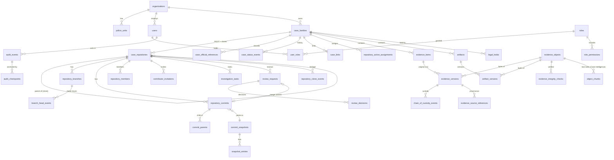

# 05. Database and ER diagram

> **Earlier design (superseded on 2026-11-10).** This document describes the first, git-style design of Case Management: an original repository, clones, branches, commits, reviews, merges and invitations. The owner asked for that to be removed completely and replaced by a plain case (permanent folders made at registration, files with versions, a team the Investigator builds directly, one numbered history). **The current design is in [13-plain-case-design.md](13-plain-case-design.md).** It is kept here for the record: where it says repository, clone, branch, commit, review or invitation, read the plain case instead. Migration 0019 replaced the repository, branch, commit, snapshot, review and invitation tables with folders, team members and history entries (document 13, section 4).

For developers. PostgreSQL 17 with Alembic migrations (`0007` onwards). The existing 13 tables stay. Two of them are extended: `users` and `audit_events`.

## 1. ER diagram

The main relationships (renders on GitHub; in VS Code, install a Mermaid preview extension).

## 2. Tables

**Kind:**
- **A** = append-only: no `UPDATE`, no `DELETE`. Enforced by trigger and by database privileges.
- **S** = status-only: no `DELETE`; only the listed columns may change, and every change also writes an event.
- **R** = reference data.

### Identity and organisation

| Table | Kind | Key fields |
|---|---|---|
| `organizations` | R | id, code (case-ID prefix, e.g. `KH`), name. Never deleted; the name may change, the code only until the organisation's first case (CM-1, decision D13) |
| `police_units` | R | id, organization_id, parent_unit_id, name, code |
| `users` *(existing)* | S | + organization_id, unit_id, org_role, mfa_enabled, mfa_secret (encrypted). Changeable: role, clearance, is_active, password, MFA |
| `roles`, `permissions`, `role_permissions` | R | the permission matrix of [04 §6.3](04-low-level-design.md), as data |
| `user_roles` | S | user_id, role_id, unit_id (scope), granted_by/at, revoked_by/at |

### Case registry

| Table | Kind | Key fields |
|---|---|---|
| `case_families` | S | id, organization_id, unit_id, **display_id** (unique per organisation), title, **case_type**, description, priority, classification, jurisdiction, supervisor_id, created_by, created_at, retention_policy_id, root_repository_id. Changeable: workflow_status, official_status, supervisor_id |
| `case_official_references` | A | case_family_id, ref_type (FIR / complaint / court case…), number, issuing_authority, date, source, recorded_by, recorded_at |
| `case_status_events` | A | case_family_id, repository_id, field, old_value, new_value, actor_id, reason, at |
| `case_links` | A | case_family_id (the linking case), repository_id, branch_id, commit_id, artifact_id, path, target_family_id **or** knowledge_case_id (`cases.id`, phase CM-5), link_type, reason, created_by, created_at. *Built in CM-4:* the link itself is an artifact of type `link` in the linking case's history; this table indexes it. Unlinking withdraws the artifact in a commit (no `unlinked` row) |

### Repository versioning

| Table | Kind | Key fields |
|---|---|---|
| `case_repositories` | S | id, case_family_id, version_number (0 = ROOT), display_id, kind (root/clone), parent_repository_id, source_commit_id, source_branch_id, clone_reason, created_by, created_at. Changeable: status |
| `repository_clone_events` | A | case_family_id, source_repository_id, source_commit_id, new_repository_id, actor_id, reason, at |
| `repository_branches` | S | id, repository_id, name (unique per repository), branch_type, description, source_commit_id, created_by, created_at. Changeable: head_commit_id (forward only), status, version |
| `branch_head_events` | A | branch_id, old_head, new_head, actor_id, reason, at |
| `repository_commits` | A | **id = SHA-256**, repository_id, branch_id, author_id, created_at, message, change_type, snapshot_hash, metadata, metadata_digest, signature |
| `commit_parents` | A | commit_id, parent_commit_id, position. The parent must be older (trigger) |
| `commit_snapshots` | A | **hash**, entry_count, created_at |
| `snapshot_entries` | A | snapshot_hash, path, kind, item_id, version_id, object_sha256, status. Unique (snapshot_hash, path) |
| `repository_active_assignments` | S | case_family_id, user_id, repository_id, role, active_from. Changeable: active_until. Unique active row per (family, user) |

### Evidence

| Table | Kind | Key fields |
|---|---|---|
| `evidence_objects` | A | **sha256**, size_bytes, mime_type (from the bytes), storage_backend, storage_key, stored_at. *(retain_until: with write-once S3, D14)* |
| `evidence_items` | S | id, case_family_id, display_id (`EV-0001`), title, evidence_type, category, classification, description, source, collected_at + collected_tz, collected_by, collection_authority, created_by, created_at. Changeable: sealed, sealed_reason, sealed_by, sealed_at |
| `evidence_versions` | A | id, evidence_item_id (**unique**), version_number (**must be 1**), object_sha256, original_filename, display_filename, mime_type, declared_mime_type, size_bytes, active_content, uploaded_by, uploaded_at, repository_id, branch_id, commit_id. A trigger checks the repository and commit belong to the exhibit's case |
| `artifacts` | S | id, case_family_id, display_id, artifact_type (note / analysis / transcription / timeline / report / import / link), title, created_by, created_at. Changeable (CM-3): sealed, sealed_reason, sealed_by, sealed_at |
| `artifact_versions` | A | id, artifact_id, version_number, object_sha256 **or** content (JSON), derived_from (list of evidence/artifact versions), author_id, created_at, change_note |
| `evidence_source_references` | A | version_id, source_system, source_record_id, source_hash, original_reference, imported_by, imported_at |
| `chain_of_custody_events` | A | id, evidence_item_id, evidence_version_id, event_type, actor_id, from/to_custodian_id (a user) or _name (an outside body), occurred_at (UTC) + occurred_tz, recorded_at, reason, method, verification_sha256, related_event_id (an acknowledgement or decline points at its transfer), authorization_ref, token_id (unique: a download link works once), details |
| `evidence_integrity_checks` | A | id, object_sha256, evidence_item_id, checked_at, checked_by (none for a system job), trigger (manual / scheduled / download / preview / acknowledgement / upload), result (match / mismatch / missing), computed_sha256. *Built in CM-8:* an index on (evidence_item_id, id) for live pages (migration 0015) |
| `object_texts`, `object_chunks` | A | sha256, page texts / passages with page ranges, embedding, search vector (Case Intelligence). *Built in CM-5 (migration 0012):* keyed by (source_kind, sha256), so notes and analyses are indexed like files; three tables: `object_texts` (A: status, extractor, page count, provisions, warnings), `object_pages` (A: page texts) and `object_chunks` (S: only embedding and embedding_model change). Who may see a text is decided per request, never stored |

### Collaboration

| Table | Kind | Key fields |
|---|---|---|
| `repository_members` | S | repository_id, user_id, role, branch_scope (assigned branch IDs, CM-3), granted_by, granted_at. Changeable: revoked_by, revoked_at |
| `contributor_invitations` | S | repository_id, case_family_id, invitee_id, role, branch_scope, message, invited_by, approval_required, created_at, expires_at. Changeable: status, approved_by, approved_at, decided_by, decided_at, decision_reason. One open invitation per person and repository |
| `investigation_tasks` | S | repository_id, case_family_id, display_id (`TASK-0001`), title, description, assignee_id, branch_id, commit_id, due_at, created_by. Changeable: status, assignee_id, version (each change also in `task_events`) |
| `task_events` | A | task_id, field, old, new, actor_id, at |
| `comments` | A | repository_id, target_type, target_id, author_id, body, created_at, replaces_comment_id |
| `review_requests` | S | repository_id, case_family_id, display_id (`RV-0001`), source_branch_id, target_branch_id, title, description, findings, linked_task_ids, author_id, reviewer_id, created_at. Changeable: status, merge_commit_id, version. One open review per branch |
| `review_decisions` | A | review_id, reviewer_id, decision, comment, source_head and target_head (what was decided on), decided_at |
| `notifications` | S | user_id, kind, payload, created_at. Changeable: read_at |

### Governance

| Table | Kind | Key fields |
|---|---|---|
| `audit_events` *(existing)* | A for `cm.*` | *Built in CM-7:* + **chain_seq** (unique), **prev_hash**, **hash**, filled by the database for Case Management events, which then can't change; other events keep their retention rule |
| `audit_checkpoints` | A | chain_seq (unique), chain_hash, signature (HMAC-SHA256), key_id (a fingerprint of the key), reason (manual / scheduled), stored_sha256 + storage_key (the file in the write-once store), created_by, created_at |
| `authorization_events` | A | organization_id, case_family_id, repository_id, user_id, change (CM-3: membership_granted / membership_revoked; roles and clearances later), old_value, new_value, actor_id, reason, at |
| `legal_holds` | S | organization_id, case_family_id, reason, authority_ref, placed_by, placed_at. Changeable: released_by, released_at, release_reason |
| `retention_policies` | S | organization_id, code (unique per organisation), name, description, review_after_years, case_types (empty: all), legal_basis, created_by, created_at. Changeable: status (active / retired) |
| `retention_decisions` | S | case_family_id, policy_id, action (retain / archive / transfer / dispose), reason, review_on, transfer_to, proposed_by, proposed_at. Changeable: status, decided_by (never the proposer: a constraint), decided_at, decision_note. Nothing is ever deleted |
| `report_exports` | A | case_family_id, repository_id, branch_id, commit_id (adding it), subject_commit_id (described), artifact_id, artifact_version_id (unique), report_type, purpose, file_format, sha256, size_bytes, page_count, storage_key, withheld_entries, generated_by, generated_at |
| `report_verifications` | A | *CM-7:* report_export_id (none: a submitted copy matching no report), method (stored_copy / submitted_copy), result (match / mismatch / missing / unknown), computed_sha256, checked_by, checked_at |
| `report_downloads` | A | *CM-7:* report_export_id, token_id (unique: a link works once), downloaded_by, downloaded_at, verified_sha256 |
| `job_runs` | A | *CM-7:* job (audit_checkpoint / audit_verify / evidence_sweep), started_at, finished_at, status (ok / warning / failed), summary, started_by (none: the worker) |
| `user_mfa` | — | *CM-7:* user_id, secret_encrypted (with MFA_KEY), confirmed_at, last_step (each code works once), created_at |
| `idempotency_keys` | A | key (unique per user), user_id, endpoint, request_hash, status_code, response, created_at |

### Integrations (*built in CM-6, migration 0013*)

| Table | Kind | Key fields |
|---|---|---|
| `integration_sources` | S | organization_id, code (unique per organisation), name, kind, description, legal_basis, allowed_item_types, authority_required_for, min_case_classification, fictional, created_by, created_at. Changeable: status, key_hash (the key's SHA-256; the key is never stored), key_prefix, key_issued_at |
| `integration_source_events` | A | source_id, event_type (registered / disabled / enabled / key_rotated), actor_id, reason, key_prefix, occurred_at |
| `integration_imports` | A | organization_id, source_id, case_family_id, repository_id, branch_id, commit_id, artifact_id, artifact_version_id (unique), path, item_type, source_record_id, source_hash, payload_ref, authority_ref, observed_at + observed_tz, observed_until, key_prefix, imported_by, imported_at. The finding itself is an artifact of type `import` (`IMP-0001`); a record changed at its source is a new version |
| `integration_indicators` | A | import_id, organization_id, case_family_id, indicator_type (ip / domain / url / email / phone / imei / imsi / account / file_hash), value (normal form). Index on (organization, type, value) to find the same identifier in other cases |

## 3. Constraints that carry the rules

- `case_repositories.case_family_id` is not null. A clone has a non-null `parent_repository_id` and `source_commit_id`, and the source commit belongs to the same family (trigger).
- Branch heads must reference a commit **reachable from the branch's repository**: its own commits, or ancestors through clone base commits (checked in the service; the trigger checks the family).
- Parents are older than their children, and commit rows never change, so the commit graph **cannot have cycles**.
- `evidence_versions.version_number = 1` exactly once per evidence item. Originals never get a second version; corrections are artifacts.
- `repository_active_assignments`: unique (case_family_id, user_id) where active_until is null.
- `case_families.display_id` is unique per organisation. **Official references live in their own table**, so they can't be confused with case IDs.
- Every table that holds case data carries `organization_id` (directly or through the family) for tenant filtering.

## 4. Indexes (main ones)

- `commit_parents(parent_commit_id)` for walking descendants, plus the primary key for walking ancestors.
- `repository_commits(repository_id, created_at desc)`.
- `snapshot_entries(object_sha256)`: which commits contain a file.
- `chain_of_custody_events(evidence_version_id, at)`.
- `audit_events(sequence)` unique.
- `repository_members(user_id) where revoked_at is null`.
- `case_families(organization_id, workflow_status)`.
