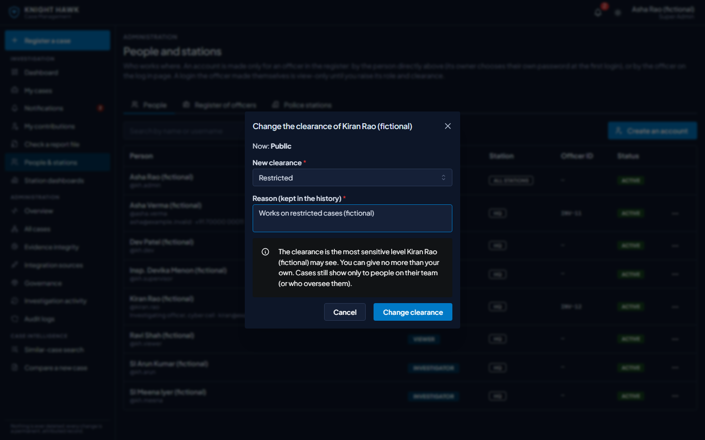
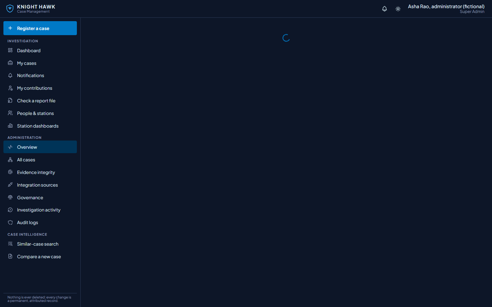
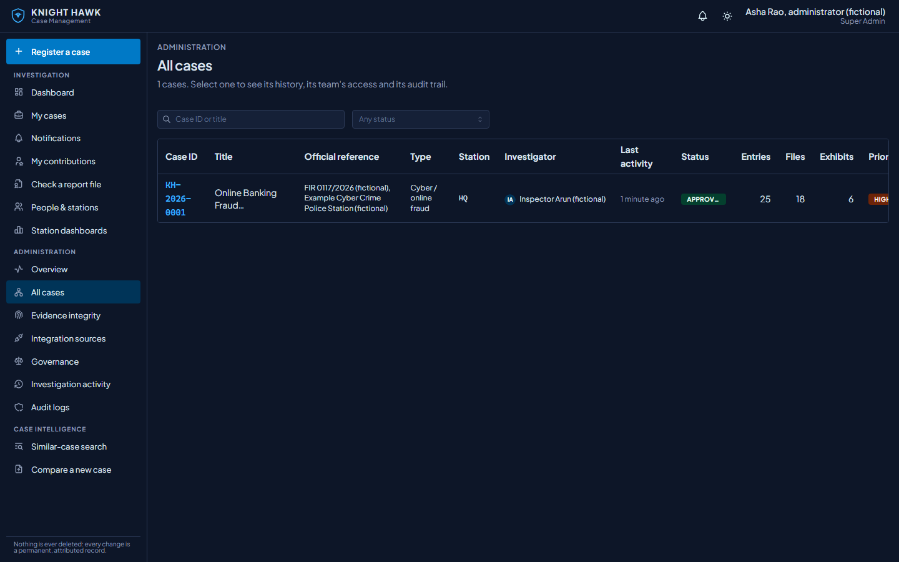
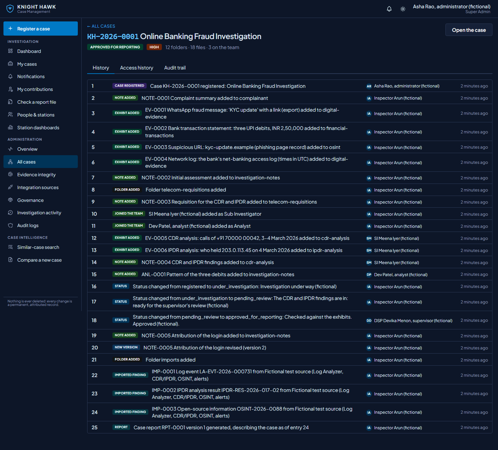
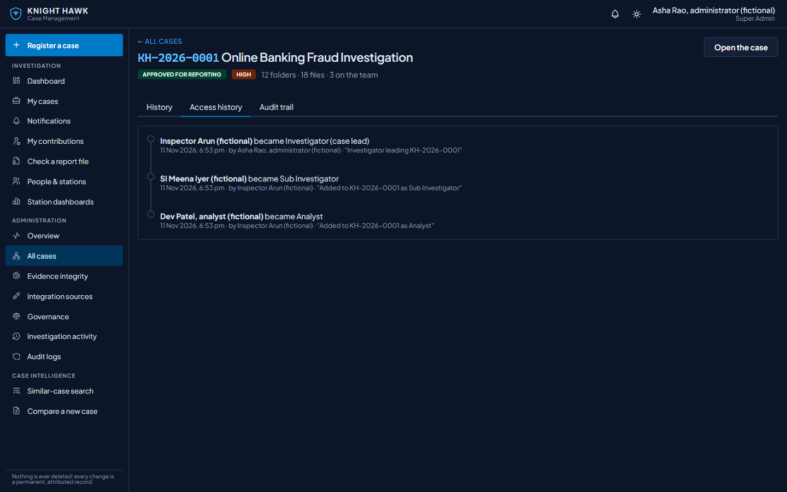
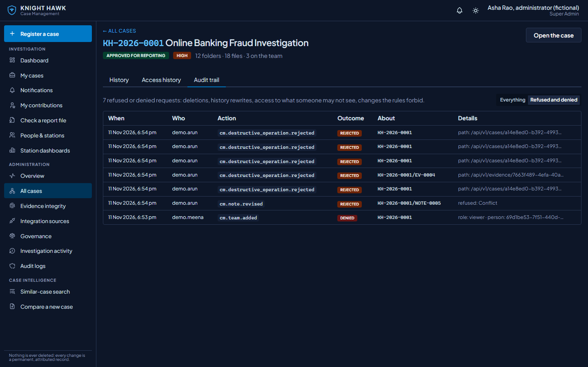
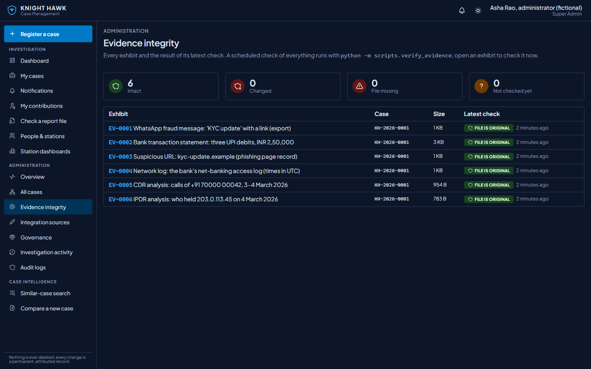
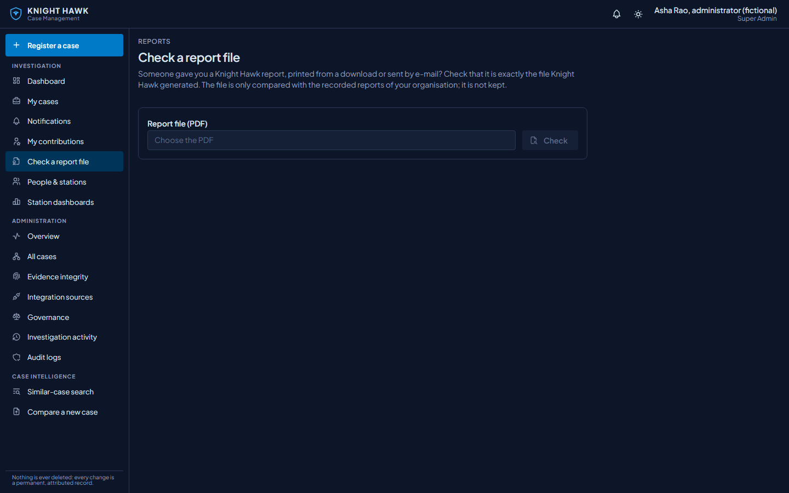

# Knight Hawk Case Management: administrator's guide

For the people who run the system: they install and update it, manage accounts and stations, watch integrity, and see every case.

Investigators and supervisors have their own guide: [investigator-guide.md](investigator-guide.md). The pictures come from the **fictional demonstration case KH-2026-0001**: every person, number and event in it is invented.

## What an administrator can and cannot do

- **Can:**
  - see every case of the organisation (a Super Admin all of them, an Administrator those of their stations), within their clearance: its folders, every file and every version of a note, the whole team (including people who left it), every entry of its history and its audit trail;
  - manage accounts, officers and police stations on the **People and stations** screens, and integration sources;
  - verify and sign the audit trail.
- **Cannot:**
  - delete or rewrite anything. Nobody can, through the application or with its database login. Every attempt is refused (HTTP 405) and recorded.
  - read a case of another organisation, or one above their clearance.

## 1. Installing, starting, updating

The whole application runs in Docker:
- the database;
- the API;
- the web server with HTTPS;
- a worker for the daily checks.

```powershell
cd C:\case-search
docker compose --profile app up -d --build     # start or update; the database is migrated automatically
docker compose --profile app ps                # what is running
docker compose --profile app logs backend      # the API's log
```

Then open https://localhost:8443. The first installation, HTTPS certificates, serving other computers and backups are explained in the root `README.md` and in `docs/steps/14-1` to `14-5`. Rebuild after every update: each start brings the database up to date and refreshes the application's own database login, which can't delete case records.

**Take a database backup before an update that changes the database** (`docs/steps/14-3-retention-and-backups.md`). Migration 0019, which replaced the earlier repository design with the plain case, **refuses to run while any case exists**: it converts nothing. A database that already holds cases of the earlier design can't be moved by it.

## 2. The organisation and its case numbers

Case numbers start with the organisation's prefix: KH is a placeholder. Set the real prefix **before the first case**; after that, the prefix is permanent. The system gives each case its number (`KH-2026-0001`); a Supervisor or an Administrator can change one case's number afterwards (pencil next to the number on the case page), with a reason. Old numbers are kept and keep finding the case, and are never reused.

```powershell
cd C:\case-search\backend
uv run python -m scripts.organisation --show
uv run python -m scripts.organisation --set-up TSP --name "Example State Police" --by admin
```

## 3. People, stations, roles and two-step verification

The organisation has **police stations**; every officer and every case belongs to one. There are **seven roles**: Super Admin, Administrator, Supervisor, Investigator, Sub Investigator, Analyst and Viewer. Each person can make accounts only for the role directly below theirs (Super Admin → Administrator → Supervisor → Investigator; an Investigator may also make another Investigator of their own station).

Everything is done on **People and stations** (in the menu):
- **Police stations**: **Open a police station**; change its name or district;
- **Register of officers**: the list of real officers (officer ID, name, rank, station and the highest role an account may have). **Add an officer**, or **Import a CSV file** (a template can be downloaded);
- **People**: **Create an account** for an officer of the register, with a role up to what the register allows. The account gets a temporary password that is shown once, to hand over; the person must choose their own at the first login. In each row's **Actions**: **Change role…**, **Change clearance…**, **Stations…**, **Reset password…**, **End account…** and **Restore account…**.

**Chat inside a case.** The people on a case's team can write to the whole team and privately to each other (a **Chat** tab on the case). The conversations belong to the team: the screens never show them to anyone else, not to a Supervisor or an Administrator who only oversees the case, and not to the Super Admin. Messages are permanent records (they cannot be edited or deleted, and they are in the backups); the audit trail records that a message was sent, in which case and whether to the team or privately, never what it said. A person taken off the team loses access at once.

**Officers can create their own login.** On the log in page, **Create your own login** asks for the officer ID, the full name exactly as in the register, a username and a password. It works only for an officer who is in the register and has no account yet; the station comes from the register. The new login starts with the least access there is (Viewer, `public` clearance): it opens no case. The Super Admin, and the Administrators and Supervisors of that station, get a notice; they then raise the **role** (never above what the register allows) and the **clearance** (never above their own, and only for people below them, at their own station), each with a reason that is kept in the access history. 

Every refusal gives the same message, so the form cannot be used to find out who is in the register, and one computer may try only a few times an hour. An officer who is not in the register must first be entered there by the Super Admin. To switch the page off, set `SELF_REGISTRATION=false` in `.env` and restart.

**Profiles.** Every person fills in and updates their own profile (email, phone, job title) under their name at the top right, **My profile**, or while creating their own login; only they can change it. The People list shows each person's job title, email and phone so that you can reach them. The audit trail records that a profile was updated and which fields changed, never the values. A person may also add a **photo** (a JPEG, PNG or WebP picture of up to 2 MB, which the server cuts to a small square and cleans of everything but the picture); it is shown next to their name in the People list, in the top bar and on case teams, to logged-in people of the same organisation only, and the audit trail records that it was changed, never the picture.

Accounts are ended, never deleted, because their actions stay attributed to them. **Clearance** (the highest classification a person may see) is `public`, `internal`, `restricted` or `confidential`. A promotion adds no power over cases that already exist.

**Two-step verification:** each person turns it on under their name → **Account and two-step verification**. Once administrators and supervisors have done so, set `CM_MFA_REQUIRED=true` in `.env` and restart. From then on, sealing, hand-overs, legal holds, status decisions and source changes need a login that used a code.

## 4. The administration overview

**Administration → Overview** shows:
- the number of cases, notes, exhibits and withdrawn files;
- history entries, in total and per day;
- cases by status and by type;
- the evidence stored and its integrity alerts;
- the latest history entries.



## 5. All cases

**All cases** is the registry of every case, with its Investigator, status, and counts of history entries, files and exhibits. Open one to see:

- **History**: every entry of the case, oldest first: who added which file, who joined or left, status changes, reports;
- **Access history**: who joined or left the team, in which part, added by whom, and why;
- **Audit trail**: every request about the case.

**Open the case** takes you to the case page itself: its files and every version of a note, and its team.





In the demonstration the history shows:
- the registration and the folders made with it;
- the exhibits and notes, with SI Meena and Dev joining the team straight in;
- the supervisor's approval;
- the wrong attribution, and its **new version** that corrected it, with version 1 kept as the record of the error.

## 6. Access history

Every addition to a team and every removal from it is a permanent record, with who did it and why. A hand-over of the case to another Investigator is recorded too.



## 7. The audit trail

Every request about a case is recorded, including every read, so the trail is long. Choose **Refused and denied** to see only what the system refused:
- attempted deletions and history rewrites;
- access to something a person may not see;
- changes the rules forbid;
- edits based on an out-of-date version of a note.



Case Management events are **chained**: each event is tied to the one before it, so an edited or removed event breaks the chain and is detected. **Audit logs**, in the menu, shows the whole system's log. Each case also has its own numbered **history** with its own check (**Check the history** on the case's History tab).

**The audit chain.** Every Case Management event is tied to the one before it, so an edited, removed or re-ordered event is detected. The worker recomputes the whole chain and writes a signed checkpoint (kept outside the database too) every day; if a check finds a problem, the administrators get a notice that leads here, to **Audit logs**. Legal holds and retention decisions are made on each case (its Overview): a Supervisor places and releases holds, and a retention decision needs a second person; an approved disposal is only recorded, the system never deletes anything.

## 8. Evidence integrity

**Evidence integrity** lists every exhibit with its latest integrity check. The worker re-hashes every stored file once a day. If a file no longer matches what was recorded, or is missing, the administrators are notified. You can run the same sweep yourself:

```powershell
uv run python -m scripts.verify_evidence
```



## 9. Integration sources

Outside systems (log analysis, CDR/IPDR analysis, OSINT, alerting) add findings to cases through the integration contract (`docs/case-management/09-integration-contract.md`, version 2.0: each call names a `case_id`).

1. Under **Integration sources**, use **Register a source** and set:
   - the kinds of findings it may send;
   - which kinds need a legal authority reference;
   - the lowest case classification it may write to.
2. Its key is shown **once**; give it to the system's operators. A key can be replaced (**Issue a new key**) and a source can be disabled.

**Add the fictional test source** lets you try the flow with invented findings. Turn it off (`CM_TEST_SOURCE=false`) before real use.

## 10. Checking a report file someone gives you

**Check a report file**: upload the PDF, and the page says whether it is exactly a report Knight Hawk generated (the file is compared with the recorded report) and which case, and which entry of its history, it describes. Every check is recorded.



## 11. The demonstration case

`scripts.demo_case` loads KH-2026-0001 into a **development or training** database:
1. It creates five fictional accounts (the administrator, the supervisor, Inspector Arun, SI Meena and Dev, an Analyst).
2. Their passwords go only into the git-ignored `.dev-credentials.txt`.
3. It then tells the 17-step acceptance story through the running application.

```powershell
uv run python -m scripts.demo_case            # through https://localhost:8443
uv run python -m scripts.demo_case --show     # is it there? which accounts exist?
```

It refuses to run:
- when `ENVIRONMENT=production`;
- while two-step verification is required;
- when the organisation already has cases (so the demonstration gets number 0001).

It never seeds twice. **Case records can't be deleted**, so never load it into a database meant for real records. The readiness check reports it if it is there.

## 12. Before real records go in

Run the readiness check and work through what it lists: `docs/case-management/11-production-readiness.md` explains each item.

```powershell
uv run python -m scripts.readiness_check
```

## 13. Troubleshooting

| What you see | What it means / what to do |
|---|---|
| A page shows "Not found" for a case you expect | It is in another organisation or another station's scope, above your clearance, or the address is wrong. The system answers the same way for all of them, by design |
| An investigator says a case vanished from their cases | They were taken off its team (see the case's Access history). Their work is kept and credited to them. The Investigator or an overseer can add them again |
| HTTP 405 in the logs or the audit trail | Someone tried to delete or rewrite history. It was refused and recorded (**Refused and denied**) |
| HTTP 409 "someone changed it" when saving a note | Two people edited the same note at the same moment. Nothing was overwritten; the second person reads the newer version and saves again |
| "History does not check out" | A history entry no longer matches its fingerprint, or one is missing. Treat it as a security incident: nothing in the application can do that. Compare with a backup and the signed audit checkpoints |
| The bell is grey | The live connection is re-establishing itself, which happens automatically |
| "Two-step verification required" on a hand-over, seal or status decision | `CM_MFA_REQUIRED=true` and the login didn't use a code. Log in again with the code |
| The worker's checks are old | `docker compose --profile app ps`: the `worker` service must be running |
