# Knight Hawk Case Management: investigator's guide

For investigators, sub investigators, analysts and supervisors who work on cases. It explains how to use the system day to day. You don't need any technical knowledge.

Every picture comes from the **fictional demonstration case KH-2026-0001**, "Online Banking Fraud Investigation". Every name, phone number, account and event in it is invented. If your administrator has loaded it, you can practise on it with the demonstration accounts:

- `demo.arun`: Inspector Arun, the Investigator who leads the case;
- `demo.meena`: SI Meena Iyer, a Sub Investigator on it;
- `demo.dev`: Dev Patel, an Analyst on it;
- `demo.supervisor`: DSP Devika Menon, the supervisor.

## The one rule behind everything

**Nothing is ever deleted or rewritten.**
- Everything that happens in a case is written into its **history**: a numbered list (entry 1, 2, 3…), each entry signed with the person's name and the time. Each entry is tied to the one before it, so none can be changed, removed or moved without it being found.
- An exhibit is kept exactly as received. The screens show **"File is original"** (or **"File was changed"**) after each automatic check; no codes are shown.
- A mistake in a note is corrected with a **new version** of that note: the old version stays readable. A wrong file is **withdrawn with a reason**: it leaves the current view and stays in the history. The mistake itself stays on record, because a court may need to see what was known when.

## 1. Logging in

Open the address your administrator gave you, and enter your username and password. The first time, you are asked to choose your own password.

**No login yet?** If you are in the officer register, choose **Create your own login** under the Log in button: type your officer ID, your full name as written in the register, a username and a password (at least 12 characters). Your login is ready at once, but it starts with view-only access and opens no case. Your Supervisor or Administrator is told, and gives you your role and clearance. If the form says the details don't match, check the ID and the spelling of your name in the register, or ask your Supervisor.

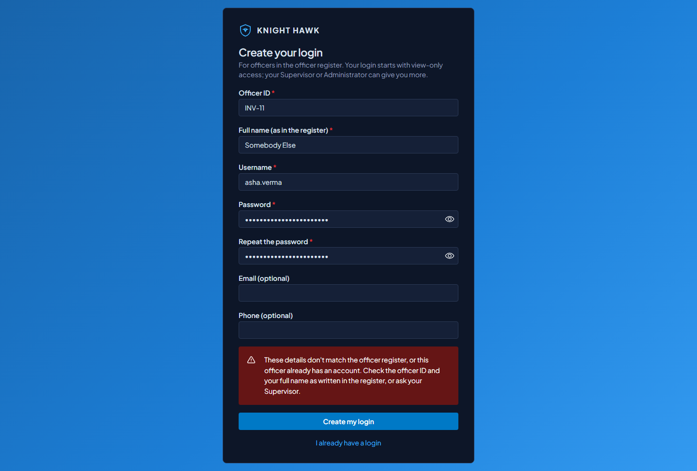

**Your profile.** The form also asks, if you wish, for your email and phone. Whoever makes your login, you can fill in or update your profile at any time: click your name at the top right and choose **My profile**. You can change your **email**, **phone** and **job title**; your name, officer ID, rank, station, role and clearance come from the officer register and your Supervisor, and are only shown. Until you have saved your profile once, the dashboard reminds you with **Complete your profile**. 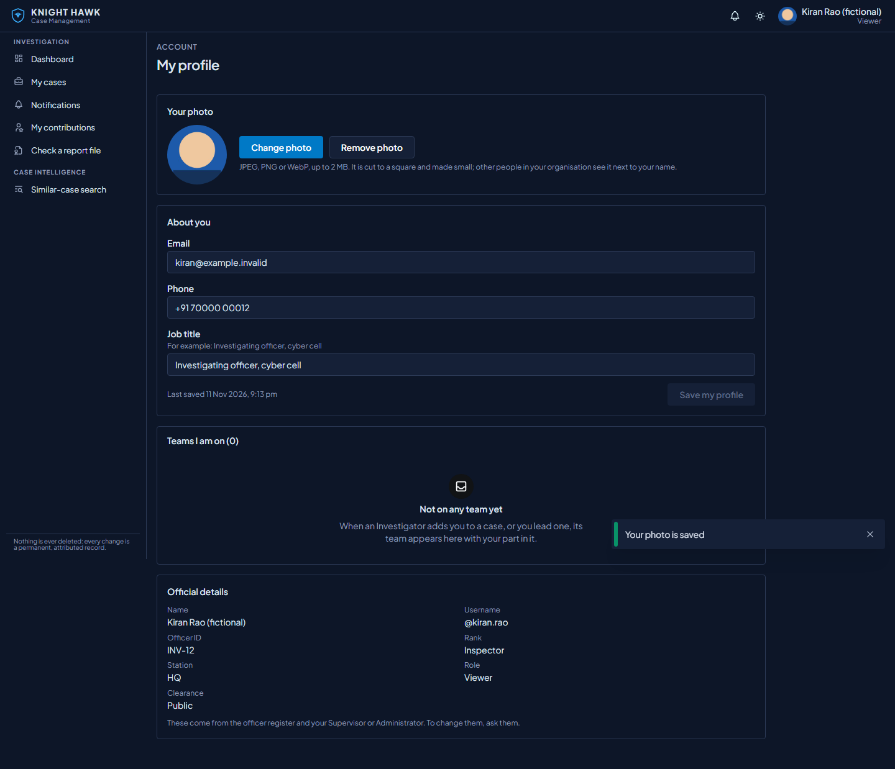

**Your photo.** On **My profile**, **Upload a photo** (or **Change photo**) lets you choose a JPEG, PNG or WebP picture of up to 2 MB. It is cut to a square and made small, and anything else in the file, such as camera or location details, is dropped. Your photo then appears next to your name at the top right, in **People and stations** and wherever your name is shown on a case. Only people who are logged in, in your organisation, can see it. **Remove photo** takes it off again.

**My profile** also lists **Teams I am on**: every case whose team you belong to (or that you lead), with your part in it, its status and its last activity; a case opens with a click. Your Supervisor and Administrator see your job title, email and phone in **People and stations**.

If two-step verification is turned on for your account, you then type the 6-digit code from the authenticator app on your phone. To set it up yourself: click your name at the top right, choose **Account and two-step verification**, then **Turn on two-step verification**, and scan the code with the app.

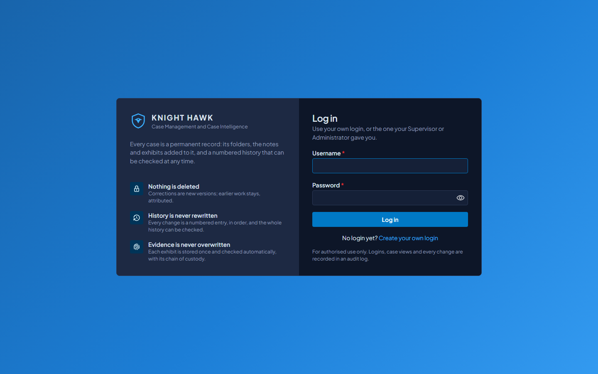

## 2. Your dashboard and your cases

**Dashboard** shows the cases you are on the team of, the work you have done and your recent notices. **My cases** in the menu lists them with **your part** in each: Investigator (case lead), Sub Investigator, Analyst or Viewer. A Supervisor or an administrator also finds the cases they oversee under **All cases I can open**.

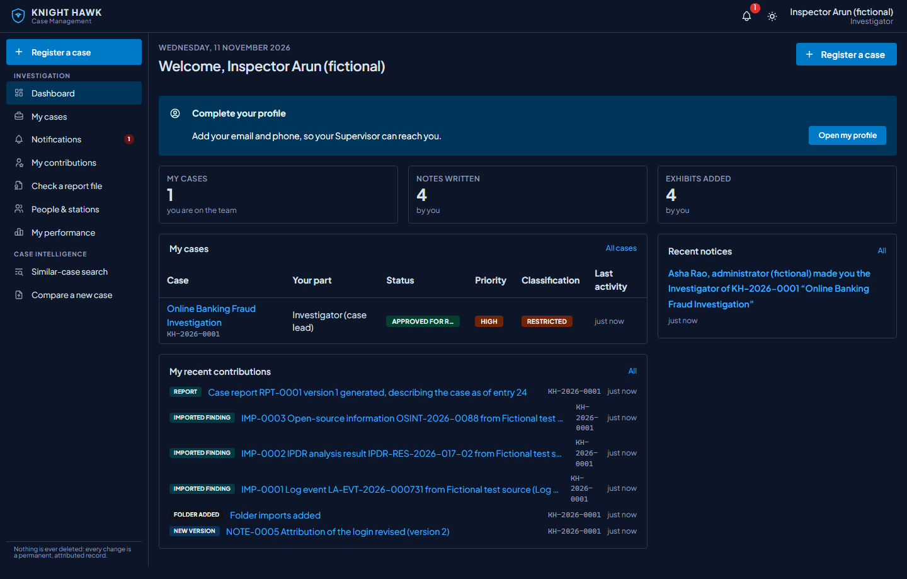

**The pages are live.** While you look at a case, colleagues may be adding files or changing its status. Your page updates by itself within a few seconds; you never need to reload. The bell at the top counts your unread notices. If it turns grey, the connection is being re-established, which happens by itself.

## 3. A case

When a case is registered, the system creates it with:
- a **number** (for example KH-2026-0001) that the system gives it. The case's **Supervisor** (or an Administrator) can change it later: click the small pencil next to the number, type the new number (3 to 32 letters, digits, spaces or . / _ -) and the reason. The old number stays on record: it still finds the case in the search, it shows under the title as *Formerly KH-2026-0001*, and it is never given to another case. The change is a numbered entry of the history with who made it and why. Reports already made keep the number they were made with. Numbers of the form KH-YYYY-NNNN are kept for new cases, and an archived case keeps its number;
- its **folders**, made automatically from the type of case (a cyber-fraud case gets `case-information`, `complainant`, `digital-evidence`, `cdr-analysis`, `ipdr-analysis`, `osint`, `financial-transactions`, `investigation-notes`, `reports` and `court-documents`);
- a summary note, and the first entry of its history;
- the Investigator who leads it, on its team.

On the **Register a case** form, the **Description** is a button: it opens a small writing window, like a new email, with a formatting bar (undo and redo, font, size, bold, italic, underline, colour, alignment, lists). **Save** keeps the text, **Discard** drops what you changed in that session. The case page shows the description the way you formatted it; reports and searches use the plain text. **Reported by** records the person who reported the case (name, phone, email, address). None of it is required: tick **Unknown** when no one was there to report it.

The case page shows all of this. A badge says your part in it. The tabs along the top are your workspace: **Overview**, **Files**, **Team**, **History**, **Links**, **Reports**, **Insights** and **Imports**.

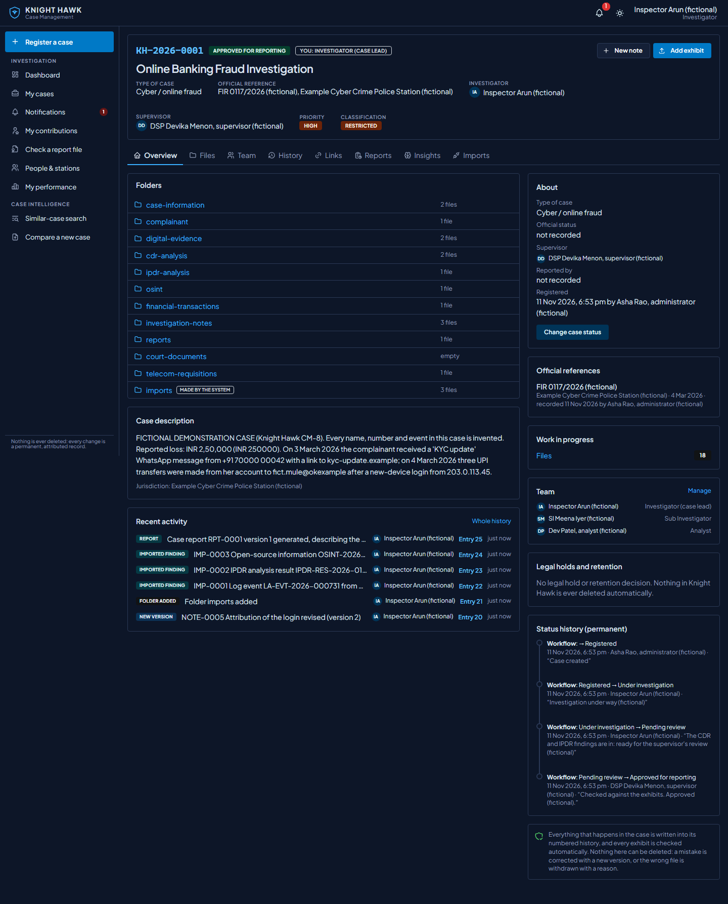

The **Overview** shows the folders, the description, the latest entries of the history, the official references, the team, any legal hold and the status. The **Investigator** and the **supervisor** can change the case's status (the supervisor alone closes, archives or reopens it).

## 4. Adding exhibits

1. Click **Add exhibit**, either at the top or in **Files**.
2. Choose the file. Then fill in:
   - **Folder**: the case type's folders are offered, such as `cdr-analysis` and `financial-transactions`;
   - **Type of exhibit** and **Title**.
3. Fill in the **provenance**:
   - where the file came from;
   - when and by whom it was collected (**Collected at** records your time zone with the time);
   - the **collection authority**, such as a seizure memo, a court order or a notice number.
4. Click **Add to the case**.

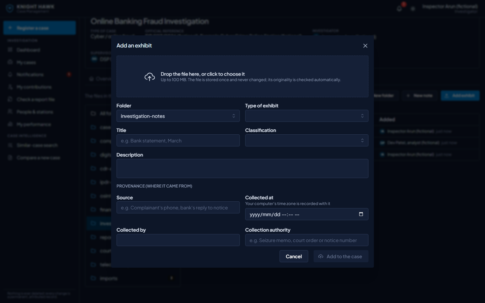

The system then does the following by itself:
- records the file's fingerprint for later checks (never shown on screen);
- checks that the file really is what its name says;
- stores it once, write-protected, and writes it into the history;
- starts its chain of custody;
- reads its text for Case Intelligence.

On the exhibit's page (open the file in **Files**, then **Open the exhibit**) you can **Verify integrity now** at any time: the stored file is checked again against what was recorded. You can also see every custody event, and record a transfer that the receiver acknowledges.

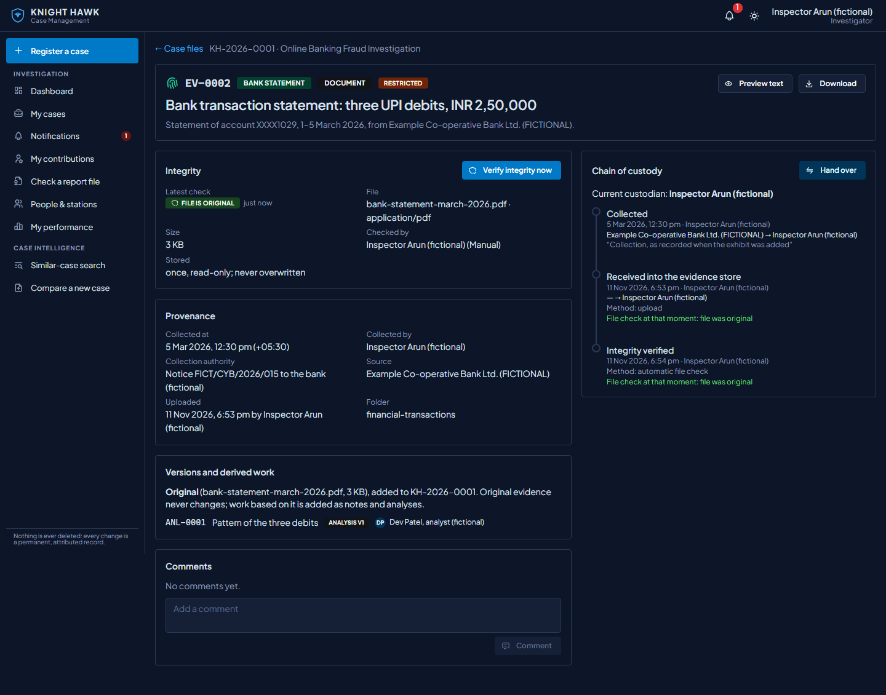

An exhibit is never changed. To correct one, add a corrected copy that refers to the original (for example a transcription made from a recording).

## 5. Folders, notes and new versions

**Files** lists the case's folders on the left, with how many files each holds, and the files of the chosen folder on the right. The Investigator (and the supervisor) can add a **New folder**: folders are flat, permanent and never renamed or removed.

Use **New note** for complaint summaries, analyses, transcriptions and findings. It is part of the case at once: there is no saving step to wait for, no review and no approval. You choose the folder and the kind of note.

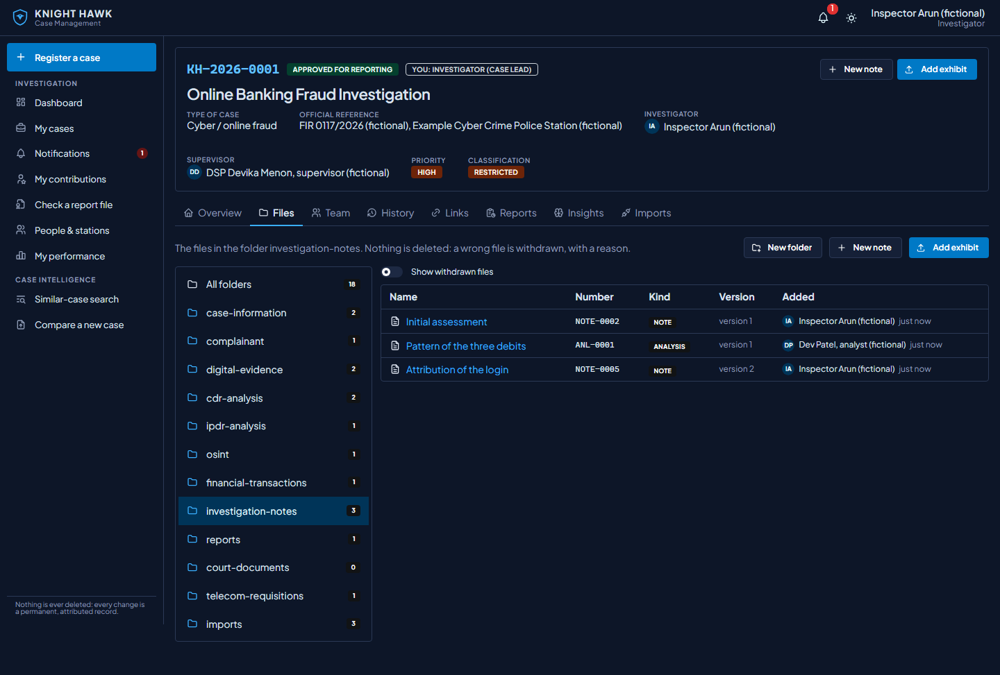

Open a note to read it. If you are allowed, you can:
- write a **New version**: it replaces nothing; the old version stays readable, with the differences shown. If a colleague made a newer version while you were editing, the system tells you instead of overwriting theirs;
- **Withdraw** it, with a reason. Only the Investigator who leads the case may do this; a **Sub Investigator or Analyst** may write new versions of their **own** notes only. A supervisor can never withdraw (delete) anything;
- **Seal** it (supervisor or administrator): only they can open it afterwards, and it is left out of reports.

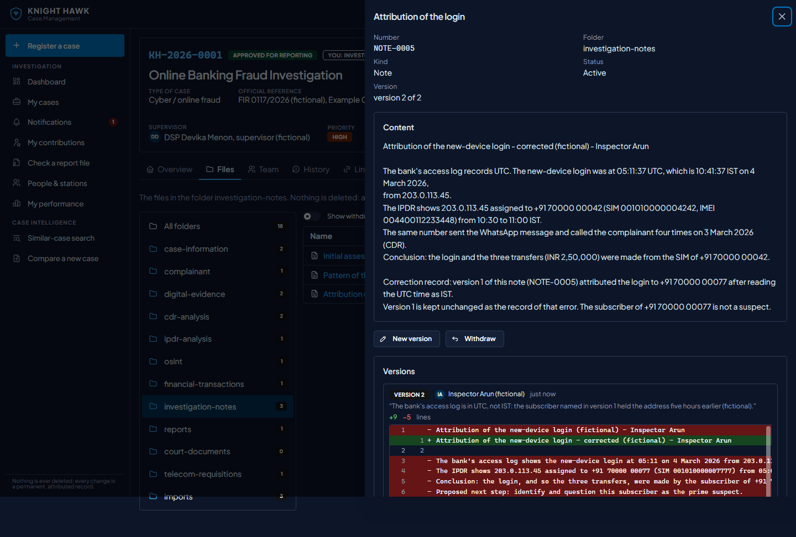

A withdrawn file disappears from the case for the whole team (the Investigator, Sub Investigators, Analysts and Viewers). It is not destroyed: the case's **Supervisor** (and the Administrator) still see it in the Files tab, **highlighted in red**, with who withdrew it, when and why. The history keeps the entry too.

## 6. The team: adding a Sub Investigator and an Analyst

The Investigator who leads a case builds its team **directly**: nobody has to accept an invitation and nobody has to approve it.

1. Open the **Team** tab and click **Add team member**.
2. Choose the colleague. Only people who work at the case's station and have enough clearance for it are listed.
3. Choose their part in the case. What is offered depends on their account:

| Part | What they do in the case |
|---|---|
| **Sub Investigator** | helps the Investigator: adds exhibits and notes, writes new versions of their own notes |
| **Analyst** | analyses the data and adds the results as notes and analyses |
| **Viewer** | only reads |

4. Click **Add to the team**. They join at once and are told by a notice.

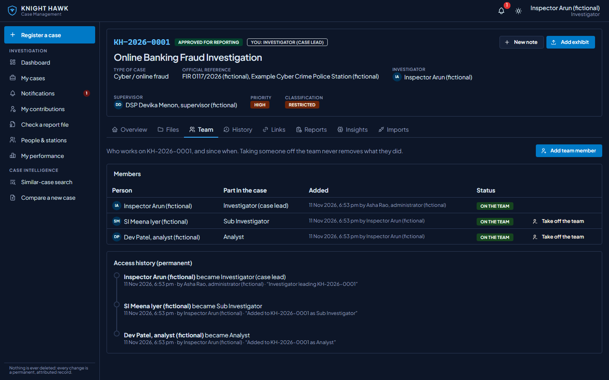

To take someone off the team, click **Take off the team** and give a reason. They lose access at once; everything they did stays in the history, credited to them. The lead can't be taken off: the **supervisor** (or an administrator) uses **Hand over the case** on the Team or Overview tab to give the case to another Investigator, with a reason. The old lead stays on the team as a Sub Investigator unless they are taken off too.

Only the Investigator who leads the case, its supervisor and the administrators can add or remove people. A Sub Investigator cannot add anyone.

**Chat with the team.** Once a case exists, everyone on its team has a **Chat** tab (the number beside it is how many messages are waiting). On the left are the conversations: **The team**, which everyone on the case team sees, and one **private conversation with each other member**, which only the two of you see. Click one, write in the box at the bottom and press **Enter** (Shift+Enter starts a new line). New messages appear by themselves within a few seconds, you get a notice for a conversation you have not read (one notice per conversation, not one per message), and opening the conversation clears it.

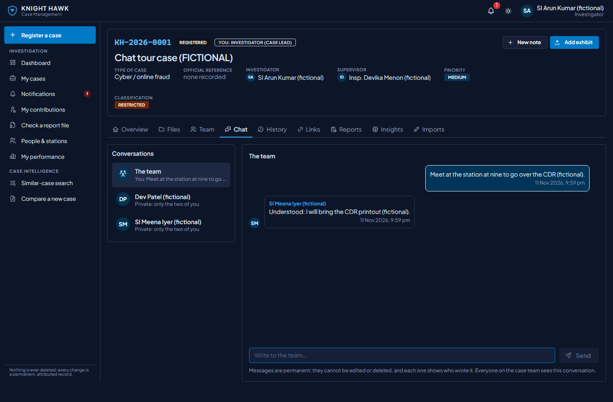

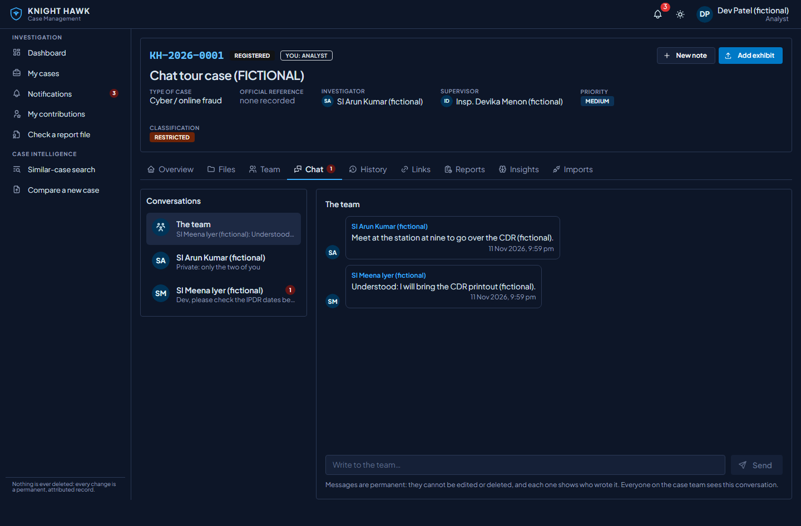

Messages are **permanent**, like everything in a case: they cannot be edited or deleted, and each shows who wrote it. People who oversee a case without being on its team (a Supervisor, an Administrator) are not in its conversations: add them to the team if they should take part. When someone is taken off the team, the conversations close to them at once. When a case is archived, its conversations are kept and can be read, but nothing new can be written.

## 7. The history

**History** lists everything that happened in the case, oldest first: who added which file, who joined or left, status changes, reports. Each line has its number. Click **Check the history** and the system recomputes every entry; it says **"History is intact"**, or names the first entry that doesn't check out, which you must report to your supervisor and an administrator at once.

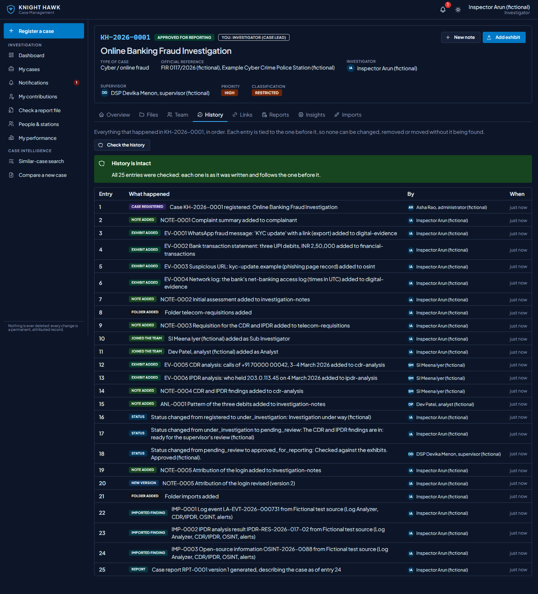

## 8. When an earlier assumption turns out to be wrong

This is what the demonstration case shows.

Inspector Arun attributed the fraudulent login to the wrong phone subscriber. The bank's log was in UTC, and he read 05:11 UTC as Indian time. The real time was 10:41 IST, and at 10:41 the IPDR points to a different number.

He doesn't edit anything away. Instead:

1. He **records the error** where it happened: he opens the wrong note and writes a comment in its panel.
2. He writes a **new version** of the note with the corrected attribution, and says why in **What changed**.

Version 1 stays, word for word, as the record of the error; version 2 is the current note. The history shows the new version as its own entry, and every entry written before it is exactly as it was.

## 9. Findings from connected systems

Systems such as a log analyser, CDR or IPDR analysis, OSINT or alerting can add findings to a case you may add to. Each finding becomes a permanent file in the case's **imports** folder, written into the history, with its provenance: the source, the record's ID, and the legal authority. A changed record arrives as a new version. Identifiers such as phone numbers, IP addresses and IMEIs are matched across the cases you may open.

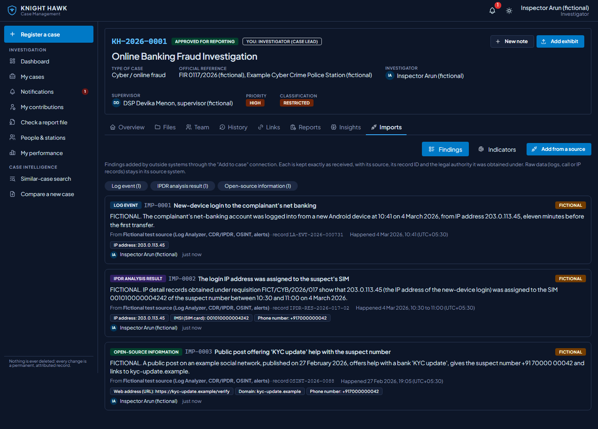

## 10. Insights (Case Intelligence)

The **Insights** tab searches inside the case, finds similar past cases and other investigations (and lets you link them), rebuilds a timeline from the documents, and suggests offence sections. You can also ask the case assistant a question: it answers only from the case's records you may see, citing the exhibit, version and page, and says so when the records don't hold the answer. Check what it says against the cited records.

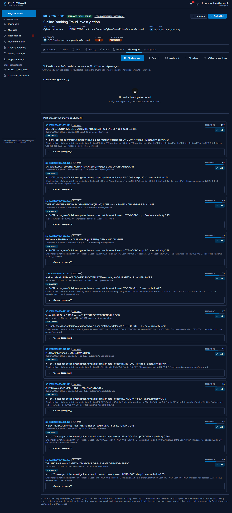

## 11. Reports

In **Reports**, choose **Generate a signed PDF** and say what the report is for. The report:
- describes the case **as of one entry of its history**, which it prints ("as of entry 41");
- includes only what every member of the case may see; sealed items are left out and counted;
- lists the exhibits with the results of their integrity checks.

It is recorded and kept write-once as a new version of the case's report. A download link works once. Later work is not in an earlier report.

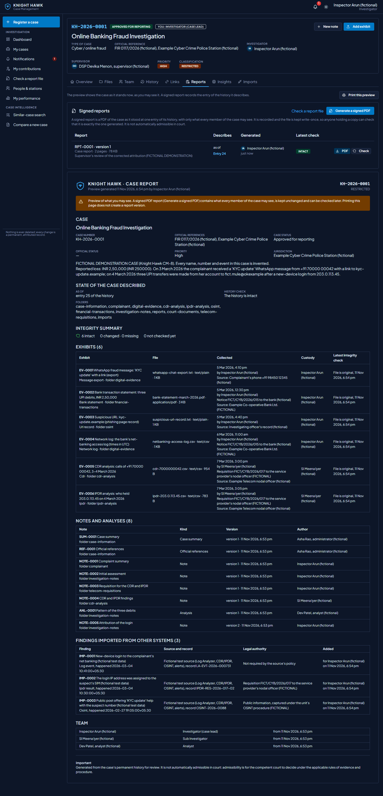

Anyone who receives a copy can check it under **Check a report file**: upload it, and the page says whether it is exactly the report Knight Hawk generated. Changing even one byte makes the check fail. A report records what the case held at that entry; it is **not automatically admissible in court**.

## 12. Your contributions and notices

**My contributions** counts the entries you made, the notes you wrote, your new versions and your exhibits. Work in a case you can no longer open (you were taken off its team) stays credited to you, shown as numbers only.

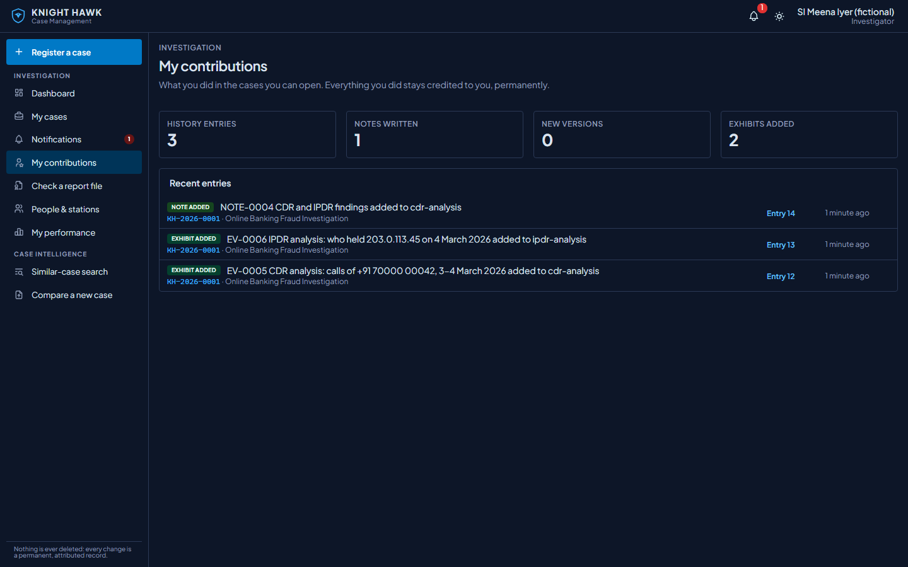

**Notifications** lists what concerns you: being added to a case or taken off one, a case handed to you, comments, imported findings and legal holds.

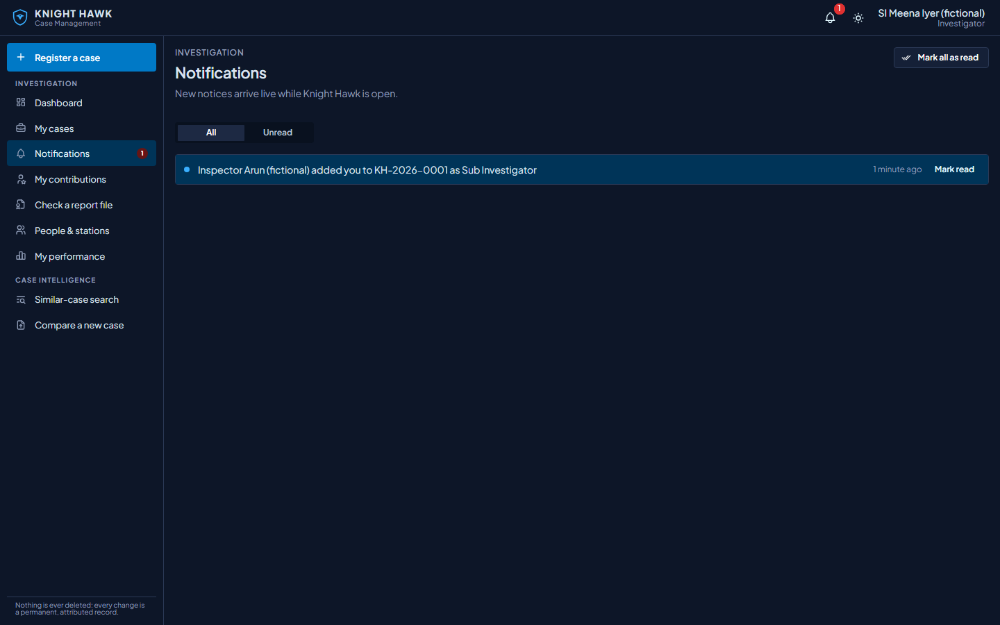

A Sub Investigator's and an Analyst's cases are listed the same way:

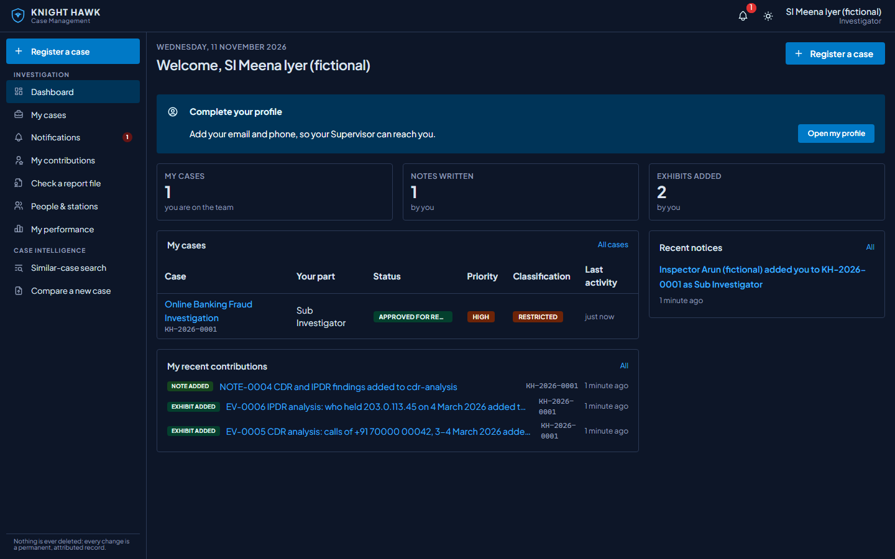

## 13. For supervisors

A supervisor sees every case they supervise (**My cases** → **All cases I can open**), reads all its files, and can add files too. From the case's Overview a supervisor can:

- **change the case's status**, including closing, archiving and reopening it, and approve the findings by setting **Approved for reporting** (the lead puts the case to *Pending review* first);
- **hand the case over** to another Investigator;
- **add or take off team members**;
- **seal** a note or exhibit;
- on the case page, **Place a hold** (a legal hold: the case can't be archived or disposed of until the hold is released with a reason);
- **Propose a decision** on retention. A second person decides, and nothing is ever deleted.

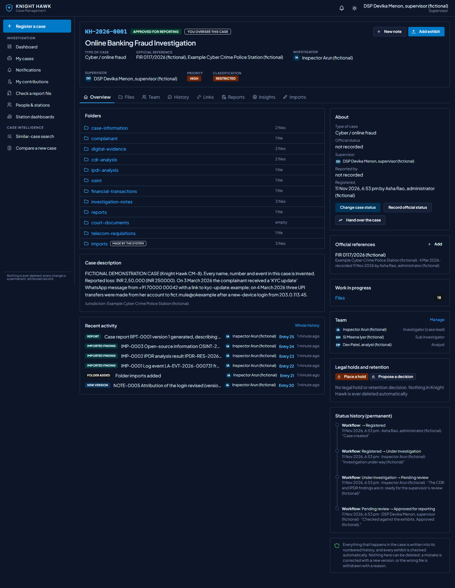

If two-step verification is required in your organisation, sealing, hand-overs, legal holds and status decisions need a login that used a code.

## 14. Questions

| Question | Answer |
|---|---|
| I uploaded the wrong file. How do I remove it? | You can't, and that is deliberate. **Withdraw** it with a reason (it stays on record, marked), then add the right file. Only the Investigator and the supervisor withdraw; ask them |
| I made a mistake in my note | Write a **New version**. The old one stays, which is how a paper file would be corrected |
| A case I worked on has disappeared from my cases | You were taken off its team. Your work stays on record and credited to you; ask the Investigator to add you again |
| "Not found" for a case a colleague mentions | You aren't on its team. The system answers exactly as if it didn't exist, by design |
| I can't add a colleague to a case | Only the Investigator who leads the case, its supervisor and an administrator add people, and only people who work at the case's station with enough clearance |
| Somebody tried to delete something | The system refused it and recorded the attempt; administrators see it in the audit trail |
| The page doesn't update | It updates within a few seconds. If the bell is grey the connection is being re-established; reloading also works |
