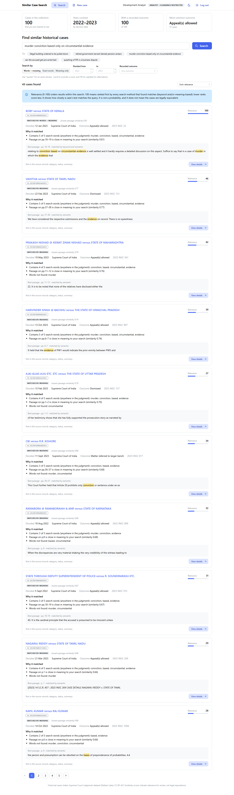

# Step 11: The web interface

Status: **done and verified** (2026-11-04). 8 frontend tests and 217 backend tests pass. The type check, lint and production build are clean. Clicked through in a real browser with no console errors.

## 1. What this module does

A browser application for everything built so far:

| Page | Address | Who | What it shows |
|---|---|---|---|
| Login | `/login` | everyone | username + password; a note that use is audited |
| **Search** (dashboard) | `/` | all roles | stat tiles for the collection; search box with examples; search type; year and outcome filters; **one card per matching case**; sort; pages of 10 |
| **Case details** | `/cases/:id` | all roles | sections **A–H** from the spec: identification, overview (parties, judges, cited provisions), timeline, outcome with its source, **similarity analysis**, documents, data quality and provenance, actions |
| **Compare** | `/cases/:id/similar` | all roles | cases similar to the selected one, with passages **side by side** and differences (outcome, year, provisions) |
| **New case** | `/new` | analyst, admin | drag-and-drop upload (PDF, Word, text) |
| **New case results** | `/uploads/:id` | the uploader | upload summary, similar cases with side-by-side passages, **Delete upload** |
| **Audit log** | `/audit` | admin | filterable table of audit events |

Screenshots of each page are in [`docs/images/`](../images/), and can serve as the visual mockups for the spec. The upload screenshots use the clearly fictional **CASE-1042** sample.



## 2. Why it is needed

The people who will use this aren't going to call an API. The interface also has to *show* the safeguards built into the backend, not just have them:
- missing information says "Not available in source";
- every score carries the note that it is not a probability or legal equivalence;
- reasons and differences sit next to each result;
- the user's role and clearance are always visible.

## 3. Files created

```
frontend/
├─ package.json, vite.config.ts      Vite dev server proxies /api to the backend; Vitest set-up
├─ postcss.config.cjs                Mantine styling
├─ index.html
└─ src/
   ├─ main.tsx                        providers: Mantine, TanStack Query, router, login
   ├─ App.tsx                         page routes; role-restricted pages
   ├─ theme.ts, styles.css            theme; print layout (no navigation or buttons)
   ├─ api/types.ts                    TypeScript versions of the backend schemas
   ├─ api/client.ts                   fetch wrapper: token, errors, expired login → login page
   ├─ api/endpoints.ts                one function per API endpoint
   ├─ auth/                           login state (context.ts, AuthContext.tsx, useAuth.ts), route guards
   ├─ lib/format.ts                   dates, page labels, "Not available in source"
   ├─ components/common.tsx           stat tile, relevance meter, section, notices, Value
   ├─ components/SnippetText.tsx      highlighted passages: always rendered as text, never HTML
   ├─ components/CaseCards.tsx        search result card, similar-case card (side-by-side passages)
   ├─ components/AppLayout.tsx        header, navigation, role/clearance badge, dark mode, log out
   ├─ pages/                          Login, Search, CaseDetails, SimilarPages (compare + upload results), NewCase, Audit, NotFound
   └─ test/, *.test.ts(x)             Vitest + Testing Library
docs/images/                          screenshots of every page
backend/app/schemas/cases.py          + `sensitivity` in case summaries (shown as a badge)
```

## 4. Packages (all MIT licence)

| Package | Version | Purpose |
|---|---|---|
| react, react-dom | 19.3 | UI library |
| vite | 8.3 | dev server and build |
| typescript | 7.0 | type checking |
| @mantine/core, hooks, dropzone, notifications | 9.7 | ready-made components (cards, tables, file drop zone) |
| @tabler/icons-react | 3.50 | icons |
| @tanstack/react-query | 5.105 | fetching and caching API data |
| react-router | 8.5 | pages and navigation |
| vitest, @testing-library/react, jsdom | 5.1 / 16.3 / 30.1 | tests |

`openapi-typescript` (to generate the API types automatically) was **not** used: it doesn't support TypeScript 7 yet. The types in `api/types.ts` were written by hand to match the backend schemas.

## 5. Commands

Run the backend and the frontend in **two terminals**:

```powershell
# Terminal 1: backend
cd backend
uv run uvicorn app.main:app --reload --port 8000

# Terminal 2: frontend
cd frontend
npm install          # first time only
npm run dev          # http://localhost:5173
```

Open **http://localhost:5173** and log in. The development accounts are in `.dev-credentials.txt`:
- `analyst` sees everything, including uploads;
- `viewer` can't upload;
- `admin` also has the audit log.

Other commands (in `frontend/`):

```powershell
npm test             # component tests
npm run build        # type check + production build into dist/
npm run lint         # oxlint
```

## 6. The code, explained

### Talking to the backend

- **No CORS set-up needed.** The Vite dev server passes every `/api/...` request to FastAPI, so the browser sees one address.
- **Every request goes through `apiFetch` (`api/client.ts`), which:**
  - adds the login token;
  - turns API errors (including validation lists) into readable messages;
  - reports "Cannot reach the server" when the backend is down;
  - on **401** (login expired), forgets the token and returns to the login page.
- **The login token lives in `sessionStorage`.** It lasts only for that browser tab and disappears when the tab closes, which suits shared office computers. Logging out also clears every cached case from memory.
- **Search text never goes in a page address.** The last search is kept in the tab's session storage (so "Back to results" works), and the query reaches the details page in router state. This matches the backend's choice of `POST` for searches: addresses end up in browser history and server logs.

### Showing data honestly

- `Value` renders an empty field as *Not available in source*. Cards say "no outcome recorded in the source" and list the fields the source doesn't record.
- Section D says plainly that **time to resolution cannot be calculated**, because the source doesn't record a filing date.
- Cited provisions are labelled "Detected automatically… check the cited pages".
- **Relevance** appears as a number with a single-colour meter. Hovering shows the backend's note: it orders results and is not a probability or legal equivalence. The same note heads every result list.
- **Outcomes get neutral grey badges.** "Appeal allowed" is neither good nor bad, so it isn't coloured as success or failure.

### Security in the interface

- **Highlighted passages are rendered as text.** `SnippetText` turns the backend's `{text, match}` parts into text and `<mark>` elements and never uses raw HTML. A test proves that `<script>` inside a document appears as plain text.
- **Pages a role can't use are hidden** (New case, Audit log), and guarded routes explain why. The backend still enforces every rule; the interface only avoids offering what will be refused.
- **External source links** open with `rel="noopener noreferrer"`.

### Layout and accessibility

- A responsive layout that works from laptop to large screens, with light and dark modes (follows the computer's setting, toggle in the header).
- The relevance meter has an `aria-label`, so screen readers read "Relevance 87 out of 100".
- **Print** on the details page prints just the case, without navigation or buttons.

## 7. How it connects to other modules

- Every page uses the endpoints from Steps 5–10. No business logic lives in the browser: ranking, explanations and access rules all come from the backend.
- **Step 12** fills section C (Timeline). The page already shows events once they exist.
- **Step 13** connects the disabled **Ask the case assistant** button in section H.
- **Step 14** builds the frontend (`npm run build`) and serves `dist/` behind the same web server as the API, with HTTPS.

## 8. How to test

```powershell
cd frontend
npm test
```

| Test | Proves |
|---|---|
| SnippetText highlights matched words | matched parts are in `<mark>` |
| SnippetText shows markup as text | `<script>` / `<b>` from a document is shown literally, never run |
| SearchResultCard | title links to the details page; "no outcome recorded in the source"; missing fields listed; citation; relevance read out as "87 out of 100"; reasons; passage pages and how they matched |
| apiFetch sends the token and repeats list parameters | `Authorization: Bearer …`; `outcome=A&outcome=B` |
| 401 = expired login | token forgotten, app told (→ login page) |
| A failed *login* is not an expired login | wrong-password 401 doesn't trigger the log-out handler |
| Validation errors | FastAPI error lists become one readable message |
| Unreachable server | "Cannot reach the server…" |

**Browser walkthrough** (Playwright, run against the real backend and dev server):
- log in;
- search "murder conviction based only on circumstantial evidence";
- open the first result;
- compare similar cases;
- upload `samples/CASE-1042-fictional.txt`, then delete it from the interface;
- log in as admin and open the audit log in dark mode.

The first run found two console errors and three presentation problems, all fixed:
1. a paragraph nested inside a paragraph in a stat tile (invalid HTML);
2. duplicate list keys when one historical passage was closest to several new-case passages;
3. "Contains 5 of 5 search words" next to "Matched by: meaning" looked contradictory. Keyword *search* needs all the words in one passage, so the reason now says "(anywhere in the judgment)";
4. the "Cnr" label became "CNR";
5. long IDs and checksums in the audit table are now shortened, with the full value on hover.

The second run had **no console errors or warnings**.

## 9. Expected output

- `npm test` → `Tests 8 passed (8)`
- `npm run build` → `✓ built`, with one notice that the bundle is over 500 kB (694 kB, 215 kB gzipped). That's acceptable for an internal tool; it can be split per page later.
- In the browser:
  - **Search:** "murder conviction based only on circumstantial evidence" lists *Boby v. State of Kerala* first (relevance 100), then *Vahitha*, *Prakash Nishad* and *Harvinder Singh*.
  - **Upload:** uploading CASE-1042 lists *Vijay Kumar Ghai v. State of West Bengal* first, with the "mere breach of contract is not cheating" passage side by side.

## 10. Common errors and fixes

| Symptom | Cause | Fix |
|---|---|---|
| "Cannot reach the server. Is the backend running?" | Backend not running on port 8000 | Start it in terminal 1 |
| Login page reappears after each click | Token rejected: `JWT_SECRET` changed, or the login expired (60 min) | Log in again |
| `npm install` fails with `EPERM` / file locked | OneDrive is syncing `node_modules` | Pause OneDrive, or move the project outside OneDrive |
| `ERESOLVE` peer-dependency error when adding a package | The package doesn't support TypeScript 7 / React 19 yet | Find an alternative. Don't force it with `--legacy-peer-deps` |
| Port 5173 in use | Another dev server is running | Stop it, or `npm run dev -- --port 5174` |
| "Not available for your role" | e.g. a viewer opening New case | Use an analyst account |
| A case opens as "Case not found" | It's above your clearance (or really doesn't exist) | Expected. See Step 10 |
| First search after starting the backend is slow | The model is still loading (~10 s) | Wait a moment |
| Blank page after `npm run build` + opening `dist/index.html` directly | The built app must be served by a web server, with `/api` reaching the backend | Use `npm run dev` for now; Step 14 sets up serving |
