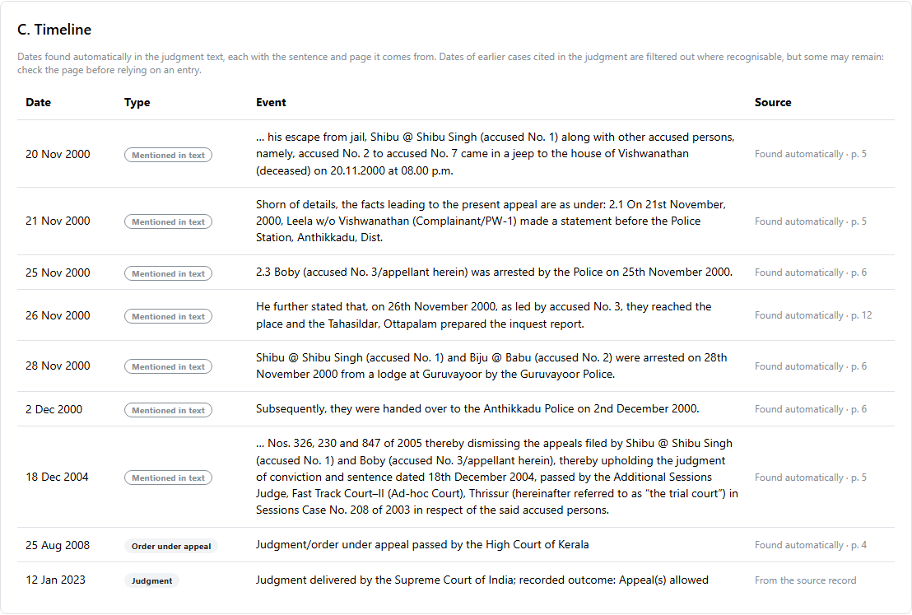

# Step 12: Case timelines and courts named

Status: **done and verified** (2026-11-05). 244 backend tests (27 new) and 8 frontend tests pass. Checked on the real judgments and in the browser.

## 1. What this module does

- **Timeline** (details page, section C). Every case gets dated events, each saying where it came from:

  | Type | From | Example |
  |---|---|---|
  | **Judgment** | the source record (decision date + recorded outcome) | "Judgment delivered by the Supreme Court of India; recorded outcome: Appeal(s) allowed" |
  | **Order under appeal** | the header line "From the Judgment and Order dated … of the …" | "Judgment/order under appeal passed by the High Court of Kerala" (25 Aug 2008, p. 4) |
  | **Mentioned in text** | any other date, with the sentence around it | "Boby (accused No. 3/appellant herein) was arrested by the Police on 25th November 2000." (p. 6) |

- **Courts and tribunals named** (details page, section B): each court under one name, with mention counts and pages. "Bombay High Court", "High Court of Bombay" and "High Court of Judicature at Bombay" all become **High Court of Bombay**.



## 2. Why it is needed

The spec asks for a timeline (events in order, with dates and references to supporting documents) and for important entities. Reading a 30-page judgment to work out what happened when is slow; the timeline gives the sequence at a glance, and every entry points to its page so it can be checked.

## 3. Files created or changed

```
backend/
├─ alembic/versions/0006_event_types_and_entities.py   case_events.event_type (+ CHECK, added by hand), case_entities
├─ app/extraction/dates.py       find dates (6 formats, calendar-checked) and the sentence around each
├─ app/extraction/courts.py      find courts/tribunals; one name each
├─ app/extraction/timeline.py    judgment, order under appeal, dated mentions; filters
├─ app/extraction/indexing.py    store per document; rebuild all from stored page text
├─ app/documents/processing.py   new documents get timeline + courts automatically
├─ app/db/models.py              + CaseEntity; CaseEvent.event_type
├─ app/schemas/cases.py          + TimelineEventOut.event_type, CaseDetail.courts
├─ app/cases/queries.py          details include courts (merged across documents)
├─ scripts/extract_timeline.py   rebuild for all documents (~7 s)
└─ tests/test_extraction.py      26 tests;  test_api_cases.py + 1
frontend/src/pages/CaseDetailsPage.tsx   timeline table with types and sources; courts in the overview
docs/images/09-overview-courts.png, 10-timeline.png
```

## 4. Packages

None added. **OpenNyAI was evaluated and not adopted for now.** The plan named it as a candidate for Indian legal entity recognition. Reasons:
- **Incompatible versions:** the [library](https://github.com/OpenNyAI/Opennyai) supports Python 3.8–3.10 with spaCy 3.2 only; this project uses Python 3.12.
- **Speed:** its [transformer model](https://huggingface.co/opennyaiorg/en_legal_ner_trf) is slow on a CPU.
- **Licence:** stated inconsistently (MIT in the model card text, Apache-2.0 in its metadata). Both are permissive, but this should be confirmed before use.
- **Little to gain:** the entity types that matter here are already covered. Parties and judges come from the metadata, statutes and provisions from Step 7, and courts and dates from this step.

It could be added later as a separate service on Python 3.10 if person or place names are needed.

## 5. Commands

```powershell
cd backend
uv run alembic upgrade head                   # applies 0006
uv run python -m scripts.extract_timeline     # timelines + courts for documents already processed
```

```
1236 timeline events from 100 documents (6.8s)
By type: dated_mention 1045, judgment 100, order_under_appeal 91
Courts named in most cases:
   20 cases  High Court of Delhi
   17 cases  High Court of Bombay
   14 cases  High Court of Allahabad
   ...
```

After changing anything in `app/extraction/`, run the script again. It reads stored page text, so it needs no PDFs and doesn't touch embeddings.

## 6. The code, explained

### Dates (`extraction/dates.py`)

Formats measured in the real text:

| Format | Example | Found |
|---|---|---|
| dd.mm.yyyy | `published on 25.12.2012` | 1,933 |
| 15th May 2018 / 2 May 2009 / 4th May, 1994 | `an order dated 15th May 2018` | 803 |
| MONTH dd, yyyy | `FEBRUARY 15, 2023` | 98 |
| dd-mm-yyyy | `order dated 17-3-2018` | 81 |
| Month dd, yyyy | `April 11, 2023` | 24 |
| dd.mm.yy | `20.05.81` | **skipped**: the century would be a guess |

- **Calendar check.** Every candidate must be a real date, so "Circular No. 89/7/2006" isn't one and neither is 31.02.2019. Numeric dates are read **day first** (Indian convention).
- **The sentence around each date** is cut from the original text, so punctuation stays as written. A list of abbreviations ("No.", "Rs.", "u/s", "Cr.P.C", initials) stops "Respondent No. 2" from being taken as a sentence end. Long sentences are trimmed to about 35 words either side of the date.

### Timeline (`extraction/timeline.py`)

- **Only plausible dates are kept:** between 1900 and the decision date. A date after the judgment can't be an event in it.
- **Dates of earlier cases are skipped.** A sentence citing another judgment is dropped ("(1984) 4 SCC 116", "AIR 1952", "supra", "decided on", "reported in"), because those dates belong to the cited case, not this one.
- **Duplicates are dropped.** One entry per date (the first mention), and the decision date isn't repeated as a "mention".
- **Long judgments are capped.** At most 40 dated mentions per document; the earliest in the text are kept, since facts usually come first.
- **Method labels.** Events from the metadata are marked `source_field`; events from text are `rule_based`. A future manual entry would be `manual`, and re-extraction never deletes manual entries.

### Courts (`extraction/courts.py`)

- Patterns: "High Court of X" (optionally "of Judicature at X"), "X High Court", and named tribunals ("Armed Forces Tribunal", "Land Tribunal", …).
- **Generic phrases are skipped:** "the High Court" (159 mentions in the 100 judgments), "the Tribunal", "Division Bench".
- "Bench at Indore" and similar endings are removed, and "&" becomes "and".
- **Errors found in the real data, all fixed with tests:**
  - "To The Tribunal" was taken as a name;
  - "High Court of Delhi and Calcutta High Court" was read as one court (it is two);
  - "Kerela" (a misspelling in a judgment) is merged into Kerala;
  - the comma in "Customs, Excise and Service Tax Appellate Tribunal" cut the name short.

## 7. Accuracy checks on the real judgments

- **Orders under appeal:** a random sample of 8 were all correct (court and date).
- **Dated mentions:** a random sample of 14 were genuine dated facts of the case (notices, arrests, bail, applications, appointments), not citations.
- **Courts:** 48 distinct names before the fixes, 43 after. Two odd one-offs remain, "High Court of Judicature" and "High Court of Registrar Orissa", each from a single unusual sentence. They're left alone rather than over-fitting the rules.
- **Bug caught by a test:** rebuilding a sentence from separate words put a space before punctuation ("05.03.2018 ."). The real data showed it too ("On 3 July 2017 , the petitioner"). Sentences are now cut from the original text.

**Limits** (also stated on the page):
- **Some dates from cited cases may remain,** where a sentence doesn't use a recognisable citation form.
- **No "what happened" summary.** The description is the sentence as written.
- **Dates written without a year** (e.g. "on 5th March") are not found.

## 8. How to test

```powershell
cd backend
uv run pytest tests/test_extraction.py tests/test_api_cases.py -v
```

| Test | Proves |
|---|---|
| date formats (7 cases) | every format above, from real sentences |
| non-dates (4 cases) | circular numbers, two-digit years, paragraph numbers, 31 February: all ignored |
| sentence around a date | abbreviations don't end sentences; punctuation is kept exactly |
| courts (12 cases) | one name per court; "and" in names vs two courts; generic phrases skipped; the real errors stay fixed |
| timeline | order under appeal with court and page; dated mention with sentence and page; cited case's date dropped; date after the decision dropped; chronological order |
| judgment event | built from the source record and labelled `source_field`; no event without a decision date; missing outcome stated |
| case details API | timeline (in order, with types, pages and methods) and courts (merged, with pages) |

## 9. Expected output

- `scripts.extract_timeline`: 1,236 events (median 10 per case, minimum 2, maximum 42), 43 distinct courts.
- In the browser, *Boby v. State of Kerala*, section C:
  - 20 Nov 2000, the incident (p. 5);
  - 21 Nov 2000, the complainant's statement (p. 5);
  - 25 and 28 Nov 2000, the arrests (p. 6);
  - 18 Dec 2004, the trial court's conviction (p. 5);
  - 25 Aug 2008, the order under appeal, High Court of Kerala (p. 4);
  - 12 Jan 2023, the judgment, from the source record.

## 10. Common errors and fixes

| Symptom | Cause | Fix |
|---|---|---|
| Section C says "No timeline has been extracted" | Timelines not built for existing documents | `uv run python -m scripts.extract_timeline` |
| `column case_events.event_type does not exist` | Migration 0006 not applied | `uv run alembic upgrade head` |
| `alembic downgrade` fails at 0006 with "constraint does not exist" | Database created before the hand-added CHECK constraint | Add it once with SQL (see `0006_event_types_and_entities.py`), or rebuild the database |
| A date from a cited judgment appears as an event | Citation written in a form the filter doesn't recognise | Add the sentence as a test in `test_extraction.py`, extend `CITES_ANOTHER_CASE`, rerun the script |
| A court appears under two names | Spelling variant not yet merged | Add it to `_ALIASES` in `courts.py`, rerun the script |
| A date in the text is missing from the timeline | Format not covered (e.g. no year), or more than 40 mentions in the document | Expected limits. Add the format to `dates.py` with a test if needed |
| Backend test run occasionally takes minutes instead of ~40 s | Seen once, not reproduced (rerun: 38 s). Likely OneDrive or virus scanning busy with new files | Re-run. If it repeats, exclude the project folder from OneDrive |
